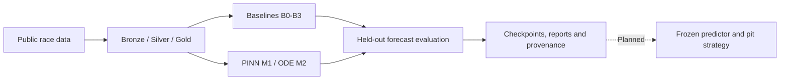
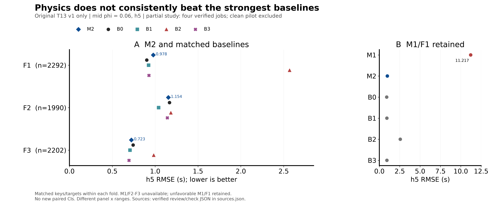

# ApexPINN

Physics-informed forecasting of Formula 1 tire degradation from public lap-time and telemetry data.
Built with **Python 3.12, JAX, Equinox, Diffrax and Optax**.

The research question: can a model with thermal and wear dynamics improve forecasts over simpler
statistical and machine-learning baselines when only public race data is available?

**Current stage:** forecasting experiments and artifact verification. The synthetic study and real-data
baseline evaluation are complete in their declared scopes. Real-data physics evaluation is partial;
predictor freezing, pit-strategy simulation and a public model/data release remain pending.

## Workflow



- **Data:** deterministic eligibility filters, circuit-grouped folds and training-only normalization.
- **Models:** a collocation PINN, a differentiable ODE model and four non-physics baselines.
- **Evaluation:** rolling forecast origins, multiple horizons, exact Gaussian-mixture uncertainty,
  calibration diagnostics and descriptive comparisons with matched baseline populations.
- **Execution:** user-launched remote GPU jobs, full-state checkpoint continuation, persistent logs
  and hash-verified input/result bundles. Local work is limited to preparation and no-fit checks.

## Evidence and limitations

| Component | Recorded status | Evidence |
| :--- | :--- | :--- |
| Synthetic identifiability study | Complete and frozen; unfavorable outcomes retained | [S1 report](reports/s1_identifiability.md) |
| Development data pipeline / G0 | Accepted in its recorded scope | [Data report](reports/data_report.md) |
| Real B0-B3 benchmark / G1 | PASS | [Baseline evaluation](reports/eval_baselines.md) |
| Real-data M1/M2 / T13 | Partial; imported M2/mid results through F5, F6 pending | [Current status](docs/status.md) |
| Clean calibration extension | Separate completed F3 pilot, not a replacement for original runs | [Method declaration](docs/calibration_clean_v1.md) |
| Frozen predictor, simulator and temporal holdout | Pending | [Remaining work](docs/status.md#remaining-work) |
| GitHub and Hugging Face release | Preparation only | [Publication plan](docs/publication.md) |



This saved figure is a **partial F1-F3 review snapshot**, not the full study. It preserves unfavorable
comparator results. Its [source hashes and visual provenance](reports/figures/review_20261107_v1/sources.json)
are retained with the figure; later F4/F5 runs are outside this snapshot.

Public telemetry provides an energy-index proxy, not direct tire force, slip, temperature or wear
measurements. A good forecast does not establish parameter identifiability or an optimal pit strategy.
Physics-model superiority and the full G2 gate are not established.

## Start here

Install the locked development environment with [uv](https://docs.astral.sh/uv/):

```bash
uv sync --frozen
```

Run the explicitly no-fit Kaggle transport/orchestration checks:

```bash
uv run --no-sync pytest -q -p no:cacheprovider tests/test_kaggle_handoff.py
```

Training is remote and user-launched. Do not execute the full test suite or training notebooks locally;
some historical tests run optimizer updates. See [reproduction and execution boundaries](docs/reproduction.md).

- [Documentation index](docs/README.md)
- [Notebook selection](notebooks/README.md)
- [Kaggle F6 setup and resume](notebooks/kaggle/README.md)
- [Colab training and result transfer](notebooks/colab/README.md)
- [Infrastructure references](infra/README.md)

## Repository layout

| Directory | Responsibility |
| :--- | :--- |
| `src/apexpinn/` | Data pipeline, physics, models, training, evaluation and artifact transport |
| `scripts/` | Reusable CLI entry points and versioned handoff builders |
| `configs/` | Scientific decisions and separately declared execution protocols |
| `tests/` | Behavioral and scientific contract checks; inspect fitting scope before running |
| `notebooks/` | Thin wrappers for user-launched remote execution |
| `reports/` | Generated scientific reports, figures and source provenance |
| `infra/`, `docker/` | Optional infrastructure and container recipes |
| `data/`, `checkpoints/` | Local data/model artifacts, excluded from new Git additions |
| `experiments/` | Scientific run records; existing tracked evidence is preserved |

Large datasets, checkpoints, credentials and workstation state do not belong in the source release.
Hugging Face dataset/model repositories and their release links have not been created by this preparation.
